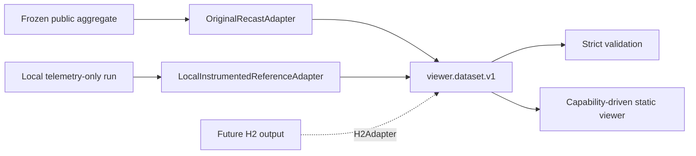

# LLP recast explorer

## What is this?

A Spanish-first static teaching tool for the public ATLAS displaced-vertex +
jets recast. It connects cut equations, weighted populations, truth decay
geometry, jet axes, and honest boolean counterfactuals without presenting the
display as reconstructed ATLAS detector data. ES is the default; the visible
ES/EN control changes all core UI and scientific explanations.

## Why reference-first?

The published aggregate and the interactive local sample have different jobs:



- `reference` is the validated inclusive strong-bm1 0j+1j+2j benchmark. Its
  exact cutflow remains authoritative and it has no invented event rows.
- `local-reference` is a separately labeled 500-event reconstructed
  strong-bm1 0j teaching sample. It contains real local telemetry and enables
  event interaction, but does not replace the inclusive benchmark.

## Architecture

- `preprocess/adapters/` contains the two source-specific adapters.
- `preprocess/instrumentation/` contains the telemetry-only C++ copy, narrow
  LHE width repair, and deterministic rerun script.
- `preprocess/schema.py` validates both aggregate and optional event packs.
- `public/data/catalog.json` lets the frontend discover datasets without
  branching on `source_kind`.
- `frontend/src/data/` strictly loads JSON; `frontend/src/core/selection.ts`
  recomputes event/vertex boolean selection, while deterministic cohorts and
  exact `d0` geometry live in small source-neutral core modules. Linked object
  identities for layers, DVs, tracks, and jets live in `core/inspection.ts`.

## Build and validate data

```bash
python3 -m venv .venv
.venv/bin/python -m pip install -e '.[dev]'
make dataset          # frozen published aggregate; no physics rerun
make local-dataset    # rebuild/run both local binaries and validate telemetry
make check
```

The compact local LHE inputs are retained under
`validation/local_reference/input/`. `make local-dataset` does not rerun
MadGraph; it compiles the unmodified and instrumented recasts, executes both
on the identical LHE/Pythia seed, adapts telemetry, and validates equality.

## Run the viewer

```bash
npm --prefix frontend install
npm --prefix frontend run dev
```

`make build` writes the static offline assets to `dist/`; there is no backend.

## What is validated?

- The public aggregate exactly reproduces all 29 frozen source checks.
- Local upstream vs instrumented stdout is byte-identical after replacing
  only Pythia's wall-clock field.
- Local telemetry exactly reproduces every printed High-pT stage and the
  27.25118% response-weighted result at six significant digits.
- Every stored radius reproduces `hypot(x,y)`; event ids, weights, jet fields,
  predicates, units, and capability dependencies are strictly validated.
- Every displayed track `d0` reproduces the C++ proxy, and per-track flags
  exactly reproduce the vertex-level selected/impacted counts.
- Counterfactuals require one vertex to satisfy every enabled DV predicate;
  predicates from different vertices are never incorrectly ANDed together.

## Current teaching content and limits

The local dataset supports linked Three.js/R–z/x–y views, OrbitControls,
deterministic 1/10/25-event cohorts, selected vertices, straight charged-
daughter directions, exact transverse `d0` construction, smeared recast jet
directions, branch fractions, and boolean cut ON/OFF. Any modified state
carries a persistent diagnostic label.
Layers, DVs, charged daughters, and jet axes are selectable. Their shared
inspector reports geometric scale, source provenance, canonical observables,
and the object's precise role in the currently selected cut.
Response maps remain a separate baseline weight: disabling a boolean cut does
not claim a detector-response counterfactual outside its validated domain.

Neutral shells are sourced nominal ATLAS Run-2 tracking landmarks; orange
surfaces are analysis limits; dashed guides are response-map bins and are off
by default. Tracks are straight truth/recast directions without helix
propagation. None of these are ATLAS hits or full detector simulation.

The H2 mass-control campaign (`make h2-datasets`) is ingested for all 8
discovered masses through the same contract, with zero H2-specific frontend
branches: full 20000-event statistics drive every cutflow number, a bounded
400-event display pack drives jet inspection, and a diagnostic jet-threshold
scale `s` (never a published ATLAS variant) reclassifies `jet_selection`
live from `jets[]` and `cuts.json.jet_logic` metadata alone. A deterministic,
pedagogically stratified 100-event geometry pack per mass
(`make h2-geometry`) recovers real DV/track/jet coordinates for a curated
subset via telemetry replay of the frozen campaign LHE/seed — see
`docs/H2_GEOMETRY_REPLAY_CONTRACT.md` for the replay contract and
`docs/DATA_CONTRACT.md`'s "Optional geometry pack" section for the schema.
The same `GeometryViewer`/`ObjectInspector` render it unmodified; `s` changes
classification only, never the 100 events' stored geometry.

## Restoring data

`public/data/` (296 MB, served by `make build` via `publicDir`) and `validation/h2_geometry_telemetry/` (298 MB) are not tracked; they are in lake commit `20261013T002548Z-190699` (sha256-identical to what git held before). From a fresh checkout run `make restore-data` (needs `rclone` with the `dihiggs_lake` remote, see `../lake/README.md`) before `make build`, `make test` or `make validate-h2`. The root Pages site (`site/`) does not build the viewer and needs no restore. `make h2-datasets` regenerates `public/data` from the campaigns instead.
